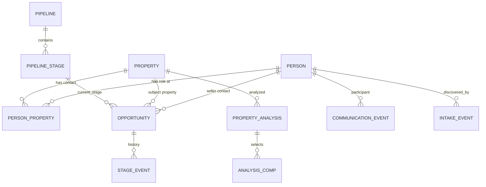

# Proposed data model

This maps the [reference workflow](README.md) to the current Twenty schema. Names are conceptual; implementation should prefer Twenty standard/custom workspace objects and metadata migrations over raw tables where practical. The reference application's internal database is not visible, and the physical schema in this checkout has not been inspected.

## Implemented first-slice model in this checkout

The standard workspace objects now include [`Property`](../../packages/twenty-server/src/modules/property/standard-objects/property.workspace-entity.ts) with an address and normalized address key, [`PersonProperty`](../../packages/twenty-server/src/modules/property/standard-objects/person-property.workspace-entity.ts) with an `OWNER` role, and an optional `Opportunity.propertyId` relation. Opportunity's seller remains `pointOfContactId`; its contact display reads the current Person record. Imported Opportunities use Twenty's existing `NEW` stage and `By Stage` Kanban. Configurable pipelines, stage history, property analysis, comps and offer formulas below remain proposals.

[`ImportBatch`](../../packages/twenty-server/src/modules/homeowner-import/standard-objects/import-batch.workspace-entity.ts) links to a named MessageList group and stores a unique active checksum, server payload digest, override choice, status and counts. [`ImportRowResult`](../../packages/twenty-server/src/modules/homeowner-import/standard-objects/import-row-result.workspace-entity.ts) links to its batch and stores a unique row number within it, outcome, reason, normalized phone and record IDs. Existing MessageListMember relations hold the resolved People in that group, including duplicates skipped for record updates. Row-result record IDs are historical scalar references rather than relations.

The homeowner import treats each row as an owner, requires phone and property street address, and matches an existing Person by normalized primary or additional phone. One match can be skipped or overridden; multiple matches require review. A matched Property is reused when its normalized address key resolves uniquely. The import service coordinates writes in one workspace transaction and optionally links an Opportunity. Import groups are intended for contact filtering and future campaign audience selection; they do not imply permission to text.

## Relationship sketch

## Existing Twenty records to reuse

| Record | Current relevant data | Proposed role / gap |
| --- | --- | --- |
| Person | Name, phones, emails, `propertyAddress`, opportunity contact relation, activity targets | Contact identity; current details shown in linked Opportunity. Its property address remains useful for the requested contact UI but is insufficient as the only property record when one Person has several properties. |
| Opportunity | Name, `stage` string, amount, close date, `pointOfContactId`, `propertyId`, company/owner relations, activity targets | Deal linked to seller Person and Property; pipeline/stage definition if multiple configurable pipelines are wanted. Its deprecated `probability` is not a replacement for deal analysis or lead temperature. |
| Task, TaskTarget | Title/body, due date, status, assignee, target relations | Deal/contact work. Add task type/snooze only if needed. |
| Note, NoteTarget | Note and generic record targets | Private team notes on Person, Property, or Opportunity; pin/visibility semantics need review. |
| Message, messaging targets | Existing connected-account communication records | Inspect channel/provider capabilities before claiming they support reference-style SMS. Existing campaign implementation in this repo is email oriented. |

Source pointers: [Person entity](../../packages/twenty-server/src/modules/person/standard-objects/person.workspace-entity.ts), [Opportunity entity](../../packages/twenty-server/src/modules/opportunity/standard-objects/opportunity.workspace-entity.ts), [Task entity](../../packages/twenty-server/src/modules/task/standard-objects/task.workspace-entity.ts), [Database map](../DATABASE_MAP.md).

## Later candidate records / tables

| Record | Main fields | Relationships and important constraints |
| --- | --- | --- |
| Property facts extension | Beds, baths, living/lot area, year built, parcel identifiers, source/timestamps | Extend the first-slice Property address model only when actual source data and units are defined. Do not globally unique on address: units and imperfect imports need review. |
| PersonProperty history extension | Valid-from/to and relationship source | Extend the first-slice owner link for temporal owner/contact roles when needed. |
| Pipeline | `id`, name, kind (seller/buyer/other), isDefault, active | Workspace-scoped; at most one default per applicable pipeline kind if supported. |
| PipelineStage | `id`, `pipelineId`, name, position, outcome category | Unique position/name within a pipeline as appropriate; an Opportunity's selected stage must belong to its pipeline. |
| StageEvent | opportunity, from/to stage, actor/source, timestamp | Append-only history for reporting and undo/audit; current stage remains on Opportunity for fast board queries. |
| PropertyAnalysis | property, optional opportunity, data provider/version, property facts snapshot, as-is estimate, ARV, repair inputs/cost, offer inputs, calculated outputs, formula version, analyzed-at | Immutable or versioned snapshot. Explicit currency, measurement units, and nullable provider estimates. One Property may have many analyses. |
| AnalysisComp | analysis, comparable address/ID, sold date/price, beds/baths/sqft, distance, selected flag, source | Store the chosen set and facts at analysis time so results remain reproducible. |
| IntakeEvent / import mapping history | Channel, external ID, mapping version, raw-row reference and retention policy | Extend the first-slice ImportBatch/ImportRowResult for webhooks and reproducible mapping history. |
| PhoneSuppression | normalized phone, scope, reason/source, created-at, optional lifted-at | Workspace-scoped unique active number/scope. Send path checks number, not merely Person. |
| CommunicationEvent | channel, direction, provider/external ID, status, person, normalized phone, optional property/deal, occurred-at, content/recording reference | Add only with an SMS/call provider design. Unique workspace+provider+external ID; retry-safe ingestion. |

The [dashboard](DASHBOARD.md) adds a reporting requirement to the communication design: distinguish outbound attempts and their status changes from accepted sends, inbound reply events, and distinct People who replied. Attribute each send to its campaign and sending number. These source records can feed date-range aggregates and number health; dashboard totals are derived values rather than independent fields on Person or Opportunity.

The [homeowner import review](IMPORTS.md) records the selected phone-match, duplicate override and group-membership rules. ImportFieldMapping and a frozen campaign audience remain later candidates. The reference import UI does not establish these rules for Twenty.

The Telnyx SMS records in [Telnyx integration notes](TELNYX.md) refine the earlier generic `CommunicationEvent` candidate into messages, provider delivery events, sending numbers, campaigns/recipients, drips, and phone consent/suppression. They are conceptual proposals, not migrations. Voice calls remain a separate provider decision.

The [Inbox review](INBOX.md) adds Conversation and ConversationView candidates. A Conversation groups activity by workspace, remote phone, and our sending number, with optional Person, Property, and Opportunity links. SMS, provider status events, and calls remain distinct records even when shown in one timeline. Unmatched inbound messages must survive contact matching.

The first slice adds **Property + PersonProperty + Opportunity→Property** and homeowner import history. Pipeline configuration and analysis snapshots are subsequent phases; see [Property and pipeline](PROPERTY_AND_PIPELINE.md).

## Data integrity and query needs

- Every new record and unique key must be scoped to the Twenty workspace and checked through its permissions model.
- Index board queries by workspace, pipeline/stage, assignee, and update date; index Property by normalized address and geographic parts; index communications/suppression by normalized phone.
- Use foreign keys for Person–Property–Opportunity and analysis/comps. Decide archival and deletion behavior so removing a pipeline card cannot erase a contact, conversation, or analysis.
- Treat names, phone numbers, emails, addresses, notes, and messages as sensitive workspace data. Restrict access, minimize logging, and define retention for raw import/provider payloads.
- Review and verify the new standard workspace metadata, physical migrations and local upgrade command in a disposable database. The earlier Person `propertyAddress` rollout does not itself create Property records.
